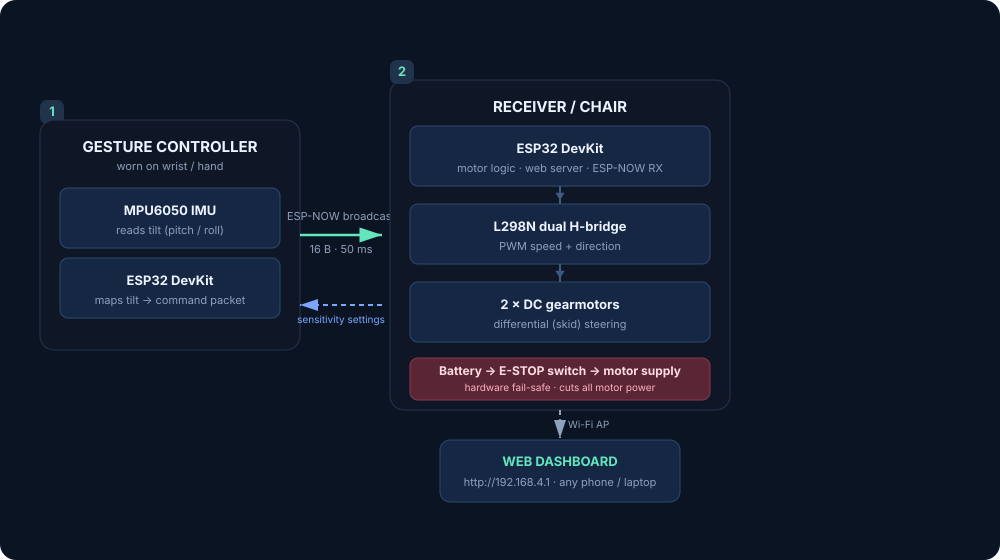
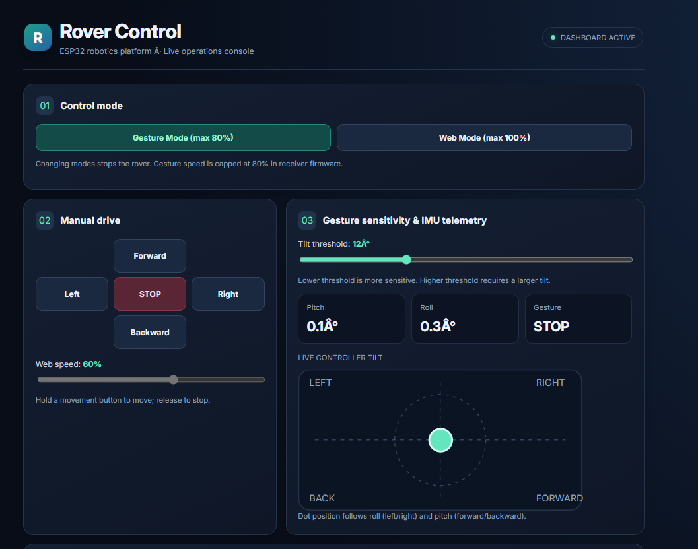
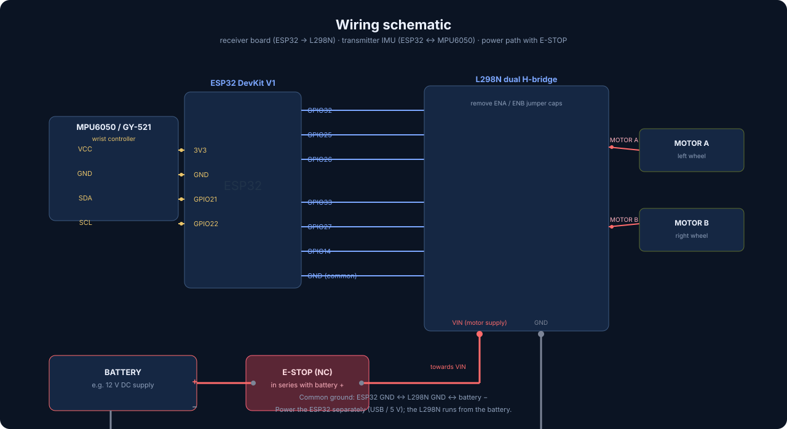
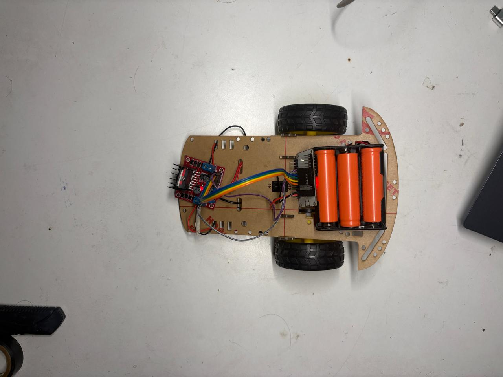
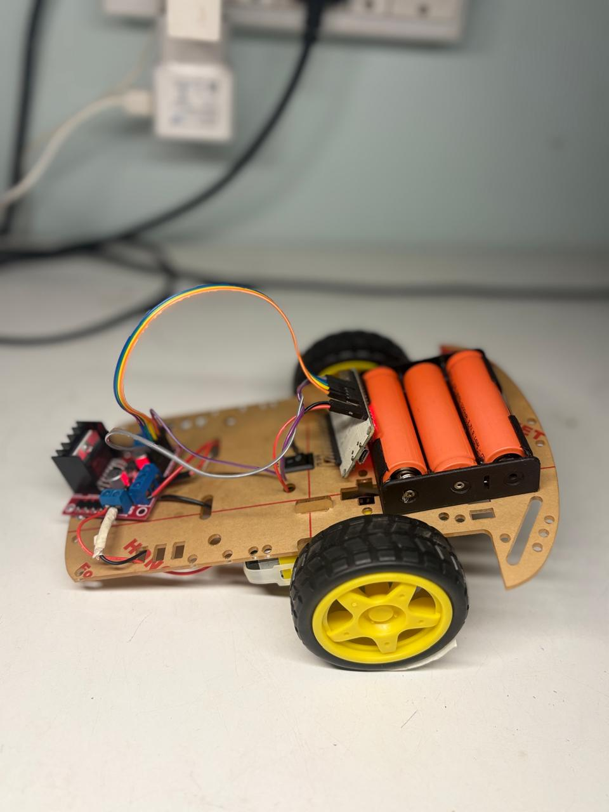

# Gesture-Controlled Smart Wheelchair Prototype

[](https://www.espressif.com/)
[](https://github.com/espressif/arduino-esp32)
[](https://github.com/sam-black007/gesture-controlled-wheelchair/releases/latest)
[](LICENSE)

A **smart wheelchair prototype** that you drive by tilting your hand, with a live
web dashboard for manual override and telemetry. Two ESP32 boards talk over
**ESP-NOW** (no Wi-Fi router needed): stick the MPU6050-equipped transmitter on
your wrist/hand, tilt it forward/back/left/right to move, and the receiver board
drives the left and right motors through an L298N H-bridge.

Built as a low-cost proof of concept for hands-free mobility assistance.

---

## Features

- **Gesture driving** — tilt detection via MPU6050 accelerometer (pitch = forward/back, roll = left/right), with adjustable sensitivity.
- **ESP-NOW wireless link** — low-latency, connection-less broadcast communication (~20 ms packets @ 50 ms interval), no router required.
- **Web control console** — a polished, responsive dark-mode dashboard hosted on the receiver's own Wi-Fi access point for:
  - Manual drive buttons + speed slider (up to 100 %)
  - Gesture sensitivity tuning (6\u201325°)
  - Live IMU tilt visualization (pitch/roll dot)
  - System diagnostics (link status, PWM, packet counters, uptime, stop reasons)
- **Smooth motor ramping** — PWM is ramped in 8/255 steps every 10 ms instead of slamming full power.
- **Momentum kick** — a one-shot 95 % PWM for 300 ms after a full stop to overcome initial inertia on motors/gearboxes, then it settles to your requested speed. The kick is **not** retriggered by repeated packets.
- **Safety built-in** —
  - **Mechanical emergency-stop switch** wired in series with the battery supply — physically cuts power, works even if firmware fails
  - Emergency stop button in the dashboard (instant cut)
  - Gesture link timeout (500 ms) and web link timeout (700 ms) auto-stop
  - Direction changes always ramps down to zero before switching the H-bridge
  - Gesture speed firmware-capped at 80 %

---

## How It Works



Every ~50 ms the transmitter estimates its tilt from the accelerometer and sends
a fixed 16-byte packet:

| Field            | Type     | Purpose                                        |
|------------------|----------|------------------------------------------------|
| `type`           | uint8_t  | `1` = gesture packet, `2` = settings packet    |
| `command`        | uint8_t  | stop / forward / backward / left / right       |
| `speedPercent`   | uint8_t  | requested speed 0–100 (capped at 80 gesture)   |
| `sensitivityDeg` | uint8_t  | tilt threshold (°), pushed back from dashboard |
| `pitch`, `roll`  | float    | live tilt angles for telemetry                 |
| `counter`        | uint32_t | packet sequence number                         |

The receiver validates each packet, ramps the PWM, and streams live status to the
dashboard as JSON over HTTP.

---

## Dashboard Preview

The control console is hosted right on the receiver at **http://192.168.4.1**
(join the `ESP32_Rover` access point). It's a responsive, dark-mode dashboard
that auto-refreshes every 500 ms:



| Panel | What it shows |
|-------|---------------|
| **01 · Control mode** | Switch between Gesture (max 80 %) and Web (max 100 %) |
| **02 · Manual drive** | Direction D-pad + web speed slider (hold to move, release to stop) |
| **03 · Gesture & IMU** | Tilt-threshold slider, live pitch / roll / gesture readouts, live tilt dot |
| **04 · System diagnostics** | Mode, movement, PWM %, gesture link, Wi-Fi RSSI, uptime, packet age, emergency-stop state, packet counters, last stop reason, motor ramp |
| **05 · Advanced connection diagnostics** | ESP-NOW channel, last packet sequence, missing (gapped) packets, live packet rate (~20 Hz), gesture-link RX signal (RSSI) |

> The **Advanced connection diagnostics** panel tracks the gesture link health:
> sequence numbers reveal lost packets, the rate chart confirms the transmitter
> is streaming (~20 Hz), and the RSSI value shows radio signal strength directly
> from received ESP-NOW packets.

---

## Hardware Required

| Component            | Qty | Notes                                  |
|----------------------|-----|----------------------------------------|
| ESP32 DevKit V1      | 2   | ESP32-WROOM-32 (one per board)         |
| MPU6050 / GY-521     | 1   | IMU on the transmitter wrist controller|
| L298N motor driver   | 1   | dual H-bridge, remove ENA/ENB jumpers  |
| 2WD chassis + motors | 1   | DC gearmotors, differential steering   |
| Battery              | 1   | matches the motor/voltage requirements |
| Emergency-stop button| 1   | NC type, in series with the battery +  |
| Jumper wires         |     | see wiring tables below                |

Full parts list with costs: **[Bill of Materials](docs/BOM.md)**.

---

## Wiring



### Receiver board (ESP32 → L298N)

| L298N | ESP32  | Function              |
|-------|--------|-----------------------|
| ENA   | GPIO32 | Left motor PWM        |
| IN1   | GPIO25 | Left direction        |
| IN2   | GPIO26 | Left direction        |
| ENB   | GPIO33 | Right motor PWM       |
| IN3   | GPIO27 | Right direction       |
| IN4   | GPIO14 | Right direction       |
| GND   | GND    | **Must share ground** |

> Remove the L298N **ENA and ENB jumper caps** — the ESP32 provides PWM.
> Keep signal wires short; power the L298N from the battery, not the ESP32 5 V rail.

### Mechanical emergency stop

A push-button (normally-closed) emergency stop is wired **in series with the
battery supply**, before it reaches the load:

```
Battery (+) ←→ E-STOP switch ←→ motor supply (+)
Battery (-) ──────────────────→ motor supply (−)
```

Pressing the switch physically **removes power from the circuit** — a true
hardware fail-safe that works even if the firmware, Wi-Fi dashboard, or the
ESP-NOW link has failed.

### Transmitter board (ESP32 → MPU6050)

| MPU6050 | ESP32 |
|---------|-------|
| VCC     | 3V3   |
| GND     | GND   |
| SDA     | GPIO21|
| SCL     | GPIO22|

---

## Hardware Gallery





---

## Getting Started

1. **Install** the [Arduino IDE](https://www.arduino.cc/en/software) and the
   [Arduino-ESP32 core (v3.x)](https://github.com/espressif/arduino-esp32).
2. **Flash the receiver** — open `firmware/Rover_Receiver_Web_Gesture/Rover_Receiver_Web_Gesture.ino`
   → select *ESP32 Dev Module* → upload.
3. **Flash the transmitter** — open `firmware/Gesture_Transmitter/Gesture_Transmitter.ino`
   → upload to the second ESP32. Keep it still and level during the ~2 s calibration.
4. **Power on** and join the receiver's Wi-Fi network:
   - **SSID:** `ESP32_Rover` · **Password:** `rover123`
   - **Dashboard:** http://192.168.4.1
5. **Test with the wheels lifted first** before floor operation (see Safety).

### Serial output

Both sketches log at 115200 baud. The transmitter prints live pitch/roll,
current command, speed, and sensitivity; the receiver prints the AP IP and
ESP-NOW init status.

---

## Operation

| Control                     | Input                              |
|-----------------------------|------------------------------------|
| Forward / Backward          | Tilt controller forward / backward |
| Left / Right                | Tilt controller left / right       |
| Web mode                    | Dashboard buttons + speed slider   |
| Adjust tilt sensitivity     | Dashboard slider (6–25°)           |
| Emergency stop              | Dashboard button                   |

- Lower sensitivity threshold = more responsive; higher = needs a larger tilt.
- In web mode the dashboard sends hold-release commands (~200 ms repeat) and
  auto-stops after 700 ms if the connection drops.
- Gesture commands are firmware-capped at **80 %**; web mode allows **100 %**.

---

## Project Layout

```
.
├── firmware/                     # All ESP32 sketches (each in its own Arduino folder)
│   ├── Rover_Receiver_Web_Gesture/
│   │   └── Rover_Receiver_Web_Gesture.ino   # Motor driver, AP + dashboard, ESP-NOW RX
│   └── Gesture_Transmitter/
│       └── Gesture_Transmitter.ino          # MPU6050 tilt sensing, ESP-NOW TX
├── docs/                         # Documentation & design files
│   ├── media/                    # Images & video (rendered by the README)
│   │   ├── diagram.svg           # Architecture diagram
│   │   ├── wiring.svg            # Wiring schematic
│   │   ├── dashboard.png         # Web dashboard screenshot
│   │   ├── hardware/
│   │   │   ├── hardware-1.jpeg   # Hardware build photo
│   │   │   └── hardware-2.jpeg   # Hardware build photo
│   │   └── demo.mp4              # Working demo video
│   ├── hardware/
│   │   ├── enclosure-remote.scad # Wrist-controller enclosure (OpenSCAD)
│   │   └── README.md             # Hardware design notes
│   ├── BOM.md                    # Bill of Materials with costs
│   └── README.md                 # Docs & media notes
├── CHANGELOG.md                  # Version history
├── .gitignore                    # Arduino / IDE build artifacts
├── README.md                     # This file
└── LICENSE                       # MIT
```

### Key firmware behavior

- **Ramping:** PWM steps toward the target by 8 counts every 10 ms.
- **Momentum kick:** one 95 % pulse for 300 ms only when starting from a full
  stop; never re-armed by repeated packets while moving.
- **Safety stops are instant** — emergency stop, gesture timeout, and web timeout
  bypass the ramp and cut PWM immediately.
- The transmitter reads the MPU6050 via direct register access (no library) and
  uses only the accelerometer for a simple, dependency-light tilt estimate.

---

## Safety & Disclaimer

This is an **unverified prototype**, not a medical device. Serious safety
considerations apply before any human use:

- **Start with the wheels lifted.** 95 % PWM and instant direction changes can
  cause sudden movement and high motor current.
- Verify motor, battery, wiring, and L298N current/temperature ratings. The
  L298N has a significant voltage drop — size your supply accordingly.
- Do not use the momentum kick to force a jammed motor.
- Phone/chest/torso-mount ergonomics and emergency cut-off positioning should be
  tested thoroughly. Keep both the **mechanical E-stop switch** and the dashboard
  **Emergency Stop** button within easy reach.
- ESP-NOW broadcast is **unauthenticated**; anyone on the Wi-Fi channel can send
  packets. For a real deployment, add crypto/authenticated pairing.

**The author is not liable for any damage or injury resulting from the use of
this prototype.**

---

## Roadmap / Ideas

- [ ] Gyro + complementary filter fusion for steadier tilt readings
- [ ] Joystick input option for users who cannot tilt reliably
- [ ] 3 × AA / LiPo voltage monitoring with low-battery warning
- [ ] Spoken feedback when switching modes

---

## Working Demo

Here's the prototype in action (gesture driving + live dashboard):

<video src="docs/media/demo.mp4" controls="true" width="100%"></video>

> Drop your demo clip at `docs/media/demo.mp4` and GitHub renders it inline on this page.

See [CHANGELOG.md](CHANGELOG.md) for version history and [Releases](https://github.com/sam-black007/gesture-controlled-wheelchair/releases) for tagged builds.

---

## License

[MIT](LICENSE) © Sam joseph thimothy
.
